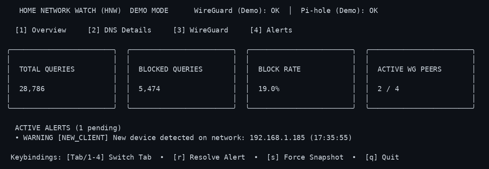

# Home Network Watch

Local-first network observability and anomaly detection for Pi-hole DNS and WireGuard VPN in Go.

[](https://github.com/khalid7344/home-network-watch/actions/workflows/ci.yml)
[](go.mod)
[](LICENSE)



Offline demo with synthetic DNS and WireGuard telemetry.

## Overview and architecture

HNW polls existing infrastructure through read-only collectors and keeps state in
local SQLite. It does not inspect packet payloads or change network configuration.

```text
Pi-hole HTTP API / wg show dump / demo collector
  -> snapshot engine -> SQLite snapshots
                     -> anomaly rules -> SQLite alerts
                     -> Bubble Tea dashboard / CLI JSON
```

`cmd/hnw` wires the CLI. `internal/collector` contains Pi-hole, WireGuard, and demo
adapters; `internal/engine/anomaly` evaluates rules; `internal/storage/sqlite`
persists state; `internal/ui/tui` renders it. SQLite is pure Go (`modernc.org/sqlite`).

## Algorithmic core

The DNS baseline is the arithmetic mean of stored query totals from the last
24 hours, excluding the snapshot being evaluated. At least two snapshots and a positive mean are required:

```text
baseline = sum(total_queries) / snapshot_count
threshold = baseline * (1 + spike_threshold_percent / 100)
alert when current_total_queries > threshold
```

The default threshold is 200% above baseline (greater than 3 times the mean).
These are API query totals, not per-second rates. Changes in the upstream
reporting window can affect comparisons.

New-client rules compare client identifiers with the previous seven days.
A WireGuard reconnection requires an updated handshake whose previous value
is older than the configured inactivity period (30 days by default).
Per-rule cooldown checks suppress repeated alerts (60 minutes by default).
New-client cooldown is shared across clients.

## Installation and quick start

### Linux amd64 release

Download [v1.0.1](https://github.com/khalid7344/home-network-watch/releases/tag/v1.0.1), verify the archive, then extract:

```sh
curl -fLO https://github.com/khalid7344/home-network-watch/releases/download/v1.0.1/hnw_v1.0.1_linux_amd64.tar.gz
curl -fLO https://github.com/khalid7344/home-network-watch/releases/download/v1.0.1/SHA256SUMS
sha256sum -c SHA256SUMS --ignore-missing
tar -xzf hnw_v1.0.1_linux_amd64.tar.gz
./hnw --version
```

### Build from source

Requires Go 1.24+ and Git. Race tests also require a C compiler. The TUI requires
an interactive terminal; the report commands below work in scripts.

```sh
git clone https://github.com/khalid7344/home-network-watch.git
cd home-network-watch
CGO_ENABLED=0 go build -trimpath -buildvcs=false -o bin/hnw ./cmd/hnw
```

For repeatable binaries, use the same source commit, Go version, GOOS, and GOARCH.
Dependencies are pinned in `go.mod` and `go.sum`; verify them with `go mod verify`.
Run `./scripts/release.sh v1.0.1` with GNU tar and gzip to build both Linux
architectures and checksums. Archive timestamps and ownership are normalized;
use the same Go toolchain to reproduce identical archives.

## Offline demonstration

From the cloned source directory after building:

```sh
./bin/hnw demo
# Noninteractive synthetic snapshot:
./bin/hnw demo --json
```

## Usage

Create a configuration from the defaults, enabling the collectors you use:

```json
{
  "pihole": {"enabled": true, "url": "http://pi.hole", "token": ""},
  "wireguard": {"enabled": true, "interface": "wg0"},
  "storage": {"db_path": "hnw.db", "retention_days": 30},
  "poll_interval_seconds": 300
}
```

Supply credentials through `HNW_PIHOLE_TOKEN`; `HNW_PIHOLE_URL` and `HNW_DB_PATH`
also override configuration. Then run:

```sh
./bin/hnw start --config config.json
./bin/hnw snapshot --config config.json
./bin/hnw status --db hnw.db --json
```

Keys: `Tab` or `1`-`4` switches tabs, `r` resolves an alert, `s` refreshes, `q` quits.
WireGuard collection executes `wg show <interface> dump`, with a `sudo wg` fallback
on failure. Access depends on host permissions; use narrowly scoped read access.
Dump output includes key material transiently; the parser retains peer public
keys and telemetry, discarding private and preshared keys. Protect API credentials,
local databases, and exports; they contain network activity and client identifiers.

## Testing and benchmarks

```sh
go vet ./...
go test -v -race ./...
go test -run '^$' -bench=. -benchmem ./...
```

The suite covers parsers, SQLite storage, mocked collectors, and anomaly rules.
No dedicated microbenchmarks are currently defined.

## Scope and limitations

Offline demo and mocked collector tests exercise synthetic telemetry; live Pi-hole
and WireGuard deployments have not been validated in this pass. The demo varies
with time and uses `hnw_demo.db` in the current directory. DNS anomaly rules use
reported totals rather than rate-normalized windows. Availability and permissions
of Pi-hole APIs and `wg` remain host-specific. No packet capture or cloud service
is involved. Back up and restrict access to the SQLite database.

## License

MIT. See [LICENSE](LICENSE). Third-party dependencies retain their own licenses.
